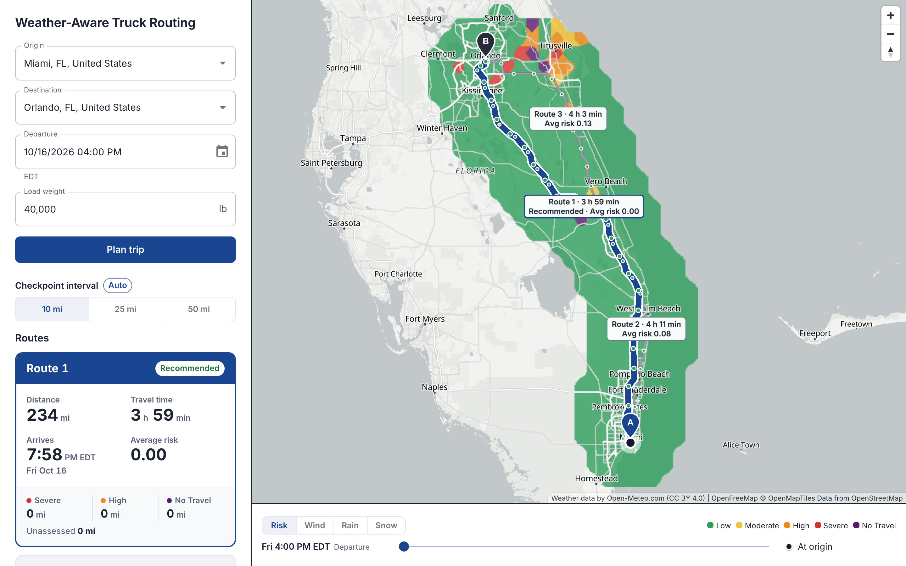
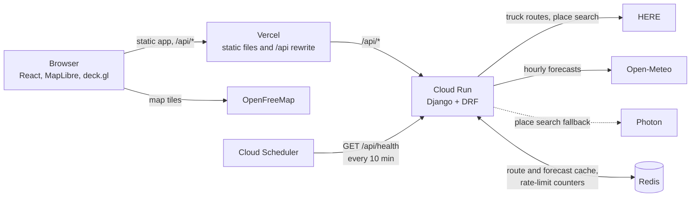

# Spotter: weather-aware truck routing

A truck driver enters an origin, a destination, a departure time and a load weight. The app finds three truck routes, forecasts the weather the truck will meet at each checkpoint at the hour it gets there, scores the risk for that load, and recommends the safest route that is not needlessly slow. A heatmap with a 0 to 48 hour slider shows the weather over the whole corridor.

**Live app: <https://spotter.murtazasaifee.com>** (the API docs are at [/api/docs](https://spotter.murtazasaifee.com/api/docs))



The server sleeps when idle, so the first request after a quiet period can take a few seconds. The app says so while it waits.

## What it does

| The brief asks for | Where it is |
| --- | --- |
| Origin, destination, departure time, load weight | Address search limited to the US, Canada and Mexico. Date-time picker in the origin's time zone. Weight in pounds, 1 to 50,000. |
| Three route options from a routing API | HERE Routing v8 in truck mode, with the truck's weight and traffic at departure. Near-duplicates are merged and detours fill the gaps. |
| Weather every 10, 25 or 50 miles at the truck's ETA | The interval is chosen from trip length, with a 10 / 25 / 50 mi override. ETAs come from HERE's segment-level time profile. Forecasts are Open-Meteo hourly data. |
| Risk from the provided rules | Wind, rain and snow thresholds plus the load rules, in one pure module ([`risk.py`](backend/api/risk.py)). |
| Recommend the best route | Fewest Severe miles, then High miles, then average risk, then travel time. "Why this route" names the deciding criterion against each alternative. |
| Routes, checkpoints, risk, ETAs and summaries on a map | All routes, risk-coloured checkpoints with ETA and conditions on hover or tap, per-route labels and cards. |
| Heatmap with a 0 to 48 hour slider | A smooth risk field over a 25 mile corridor, with a wind, rain and snow toggle and a truck marker that follows the slider. |

It also works on a phone: the panel becomes a draggable bottom sheet over a full-screen map.

## Run it locally

You need Python 3.13 with [uv](https://docs.astral.sh/uv/), and Node 24 or newer.

```sh
# Backend, on http://127.0.0.1:8000
cd backend
cp .env.example .env          # then set HERE_API_KEY
uv sync
uv run python manage.py runserver

# Frontend, on http://localhost:5173 (proxies /api to the backend)
cd frontend
npm ci
npm run dev
```

A HERE key is the only secret you need. Create a project at [platform.here.com](https://platform.here.com); the free plan asks for billing details. Open-Meteo, Photon and OpenFreeMap need no key. Without a key, place search falls back to Photon, but planning fails with `routing_unavailable`.

Locally the cache is in process memory. Set `REDIS_URL` to use Redis.

### Tests and checks

```sh
cd backend
uv run pytest                                  # no network or key needed
uv run ruff check . && uv run ruff format --check .

cd frontend
npm test
npm run lint && npm run typecheck && npm run build
```

Tests sit at three seams and check behaviour, not internals:

1. **The API** through Django's test client, with HERE, Open-Meteo and Photon answered by recorded real responses (`backend/tests/fixtures/`, `respx` intercepts all outbound HTTP).
2. **The pure risk module**, table-driven: every band edge, every load rule, the gust warning, No data, and the ranking.
3. **Whole frontend screens** with Vitest, Testing Library and MSW. Only the WebGL map is replaced by a stub.

GitHub Actions runs all of the above plus a Docker build on every push.

### Environment variables

Backend, read from `backend/.env` locally and from the host's environment in production. [`backend/.env.example`](backend/.env.example) lists every one with its meaning.

| Variable | Purpose |
| --- | --- |
| `HERE_API_KEY` | Routing and place search. Server side only. |
| `REDIS_URL` | Cache. Empty uses in-process memory. |
| `DJANGO_SECRET_KEY` | Set a long random value in production. Nothing is signed today. |
| `DJANGO_ALLOWED_HOSTS` | Comma-separated hostnames the API answers to. |
| `DJANGO_DEBUG`, `DJANGO_LOG_LEVEL` | Debugging and log level. |
| `TRUSTED_PROXY_HOPS` | Proxies in front of the API, for per-visitor rate limits. See [Rate limits](#rate-limits). |

The frontend has no environment variables. It calls `/api` on its own origin.

## Architecture



The browser talks to one origin. Vercel serves the static app and rewrites `/api/*` to Cloud Run, so there is no CORS setup. All provider keys live on the server. The backend has no database; its only storage is the cache, and every request carries everything it needs.

### Backend (`backend/api/`)

| Module | Responsibility |
| --- | --- |
| [`risk.py`](backend/api/risk.py) | The brief's rules and nothing else. Pure, no Django. Classifies a checkpoint and ranks routes. |
| [`planning.py`](backend/api/planning.py) | Orchestrates one plan: routes, interval, checkpoints, forecast, risk, ranking, notices. |
| [`routing.py`](backend/api/routing.py) | HERE adapter. Truck routes with alternatives, near-duplicate removal, detour fallback, 15 minute cache. |
| [`checkpoints.py`](backend/api/checkpoints.py) | Distance and elapsed-time profile of a route, checkpoint placement, ETAs, covered miles, automatic interval. |
| [`weather.py`](backend/api/weather.py) | Open-Meteo adapter. Batching, compact cache entries, hour selection, missing-value fallback. |
| [`lattice.py`](backend/api/lattice.py) | The 0.05 degree grid every weather lookup snaps to. |
| [`heatmap.py`](backend/api/heatmap.py) | Corridor, grid resolution and the 49 hourly frames, from the route geometries it is sent. |
| [`geo.py`](backend/api/geo.py) | Polyline coding, distances, line simplification, a spatial index for "within N miles of a route". |
| [`places.py`](backend/api/places.py) | HERE Autosuggest with Photon as a fallback; time zone from coordinates, offline. |
| [`ratelimit.py`](backend/api/ratelimit.py) | Per-visitor hourly limits. |
| `views.py`, `heatmap_views.py`, `serializers.py`, `errors.py`, `schema_examples.py` | HTTP layer, validation, the single error format, OpenAPI examples. |

### Frontend (`frontend/src/`)

React, TypeScript (strict), Vite and MUI. TanStack Query holds server state. The map is react-map-gl on MapLibre with deck.gl layers, loaded lazily so the form renders first.

| Folder | Responsibility |
| --- | --- |
| `panel/` | Trip form, recommendation, "Why this route", route cards, interval toggle. |
| `map/` | Routes, checkpoints, labels, truck marker and heatmap layers. |
| `heatmap/` | Slider, layer toggle, legend, and the Web Worker that turns the response into smooth bitmaps. |
| `risk/`, `trip/`, `truck/` | The one risk palette, departure and weight handling, truck position along a route. |
| `layout/` | Desktop side panel and phone bottom sheet. |
| `api/` | Typed client, rate-limit countdown and retry. |

The slider never touches the network. The worker builds a layer's 49 frames once, and moving the slider swaps prebuilt bitmaps with a 150 ms crossfade.

## API

Interactive docs: **[/api/docs](https://spotter.murtazasaifee.com/api/docs)** (Swagger UI). The OpenAPI document is at `/api/schema`. Every endpoint has descriptions, request and response examples, and its error responses.

| Endpoint | Purpose |
| --- | --- |
| `GET /api/places/suggest?q=` | Up to 8 North American place suggestions with coordinates and time zone. |
| `POST /api/plan` | Routes, checkpoints, risk, ranking and the recommendation. |
| `POST /api/heatmap` | 49 hourly frames of risk, wind, rain and snow over the routes a plan returned. |
| `GET /api/health` | Liveness, no dependencies. |

Every error has the same body, `{"code", "message", "details"?}`:

| Status | Code | Meaning |
| --- | --- | --- |
| 400 | `validation_error` | `details.fields` names each bad field. |
| 404 | `not_found` | Unknown path. No endpoint looks up a resource by id, so no other 404 exists. |
| 422 | `no_route_found` | HERE has no truck route between the places. |
| 429 | `rate_limit_exceeded` | The visitor's hourly allowance is used up. `details.retry_after_seconds`, also sent as the `Retry-After` header (whole seconds). |
| 429 | `weather_rate_limited` | Open-Meteo is limiting requests. `details.retry_after_seconds`, also sent as the `Retry-After` header. |
| 503 | `routing_unavailable`, `weather_unavailable`, `places_unavailable` | A provider failed or timed out. Failures are never cached. |

### Rate limits

Each visitor may make 60 plan, 60 heatmap and 300 suggestion requests per clock hour. These protect the free-tier provider quotas. Details:

- Requests are counted before validation, so malformed requests are not free either.
- Windows are fixed clock hours, not sliding, so a visitor can burst up to twice the limit across an hour boundary.
- **The limits fail open.** If the cache is unavailable the request is not limited, and the route and weather lookups fall back to calling the providers. A dead cache makes the app slower, not broken.
- Behind Vercel and Cloud Run, the connection address is Google's front end for everyone. The visitor is read from `X-Forwarded-For`, counting `TRUSTED_PROXY_HOPS` entries from the end (default 2: Vercel's egress, then Cloud Run). Entries to the left are whatever the client claimed and are ignored. `X-Real-IP` is not trusted, because Vercel passes a client's own value through.
- **Caveat:** someone who calls the Cloud Run URL directly skips Vercel and can choose their own bucket, because the headers cannot tell a forged `a, b` from Vercel's `client, egress`. Treat the limit as a quota guard, not a security boundary. A fix would need a secret shared with Vercel, or restricting Cloud Run ingress. If you deploy with a different number of proxies, set `TRUSTED_PROXY_HOPS` to match.

## How the brief was interpreted

The brief leaves some things open and the risk table is ambiguous at its edges. Each decision below is made once, in code, and covered by a test. The numbers in the code are the ones in this section.

The thresholds:

| | Low | Moderate | High | Severe | No Travel |
| --- | --- | --- | --- | --- | --- |
| Wind (mph) | < 25 | 25 to < 35 | 35 to < 45 | 45 to < 55 | ≥ 55 |
| Rain (in/hr) | < 0.10 | 0.10 to < 0.25 | 0.25 to < 0.50 | 0.50 to < 1.00 | ≥ 1.00 |
| Snow (in/hr) | < 0.5 | 0.5 to < 1.0 | 1.0 to < 2.0 | 2.0 to < 3.0 | ≥ 3.0 |

**Risk at a checkpoint**

1. **A value exactly on a band edge goes to the higher band.** The brief's ranges share their edges (0.25 in/hr rain is both Moderate and High). Erring toward caution is the only defensible reading for a safety tool. This includes the top band: the brief writes No Travel as rain "> 1.00" and snow "> 3.0", but here exactly 1.00 in/hr and 3.0 in/hr are No Travel. This is the one place where the code departs from the brief's literal text.
2. **The weight rules are strict.** "More than 30,000 lb" and "more than 40,000 lb" are read literally, so a load of exactly 30,000 or 40,000 lb is not escalated. The rules: wind ≥ 55 is No Travel for any load; 45 to 54 mph over 30,000 lb is No Travel; 35 to 44 mph over 40,000 lb is Severe. They only raise wind, and the stricter of table and load rule wins. The load rules read the cargo weight the driver enters, not the gross weight.
3. **Worst-of, combined conditions and the score bonus.** A checkpoint's level is the worst of its wind (after the load rules), rain and snow levels. The condition or conditions at that level are shown as the driver of the risk, and a Low checkpoint has none. If two or more conditions are Moderate or worse, the checkpoint is flagged as combined ("wind + snow") and its score is the level (Low 0 to No Travel 4) plus 0.5. The bonus feeds only the average-risk comparison. It never changes the displayed level, because the published table should stay true.
4. **The gust warning is informational.** Gusts go through the same wind table and load rules. A warning shows only when the gust-implied level is High or worse and higher than the sustained wind's level. Warning on every breezy checkpoint would make the signal worthless. It never changes the level, the score or the ranking, because the brief's rules are about sustained wind.
5. **No data is never Low.** If sustained wind, rain or snow is still missing after trying the hour either side, the checkpoint is No data: grey, left out of risk miles and average risk, and counted as the route's unassessed miles, with a plan-level notice. Treating "unknown" as "safe" would give false reassurance. The one exception is a known No Travel: it is the top level, so a missing value cannot change it, and the checkpoint is No Travel (driven by the known conditions) and blocks the route as usual. Any lower known level stays No data, because the missing values could raise it. A missing gust alone only drops the gust warning. A route with nothing assessed is never preferred on average risk over one that has data.
6. **Rain means rain plus showers.** Open-Meteo's `rain` is large-scale rain only; convective downpours are in `showers`. Wind is the sustained 10 m wind, and snow is inches of snow per hour.

**Checkpoints and forecasts**

7. **Forecast hour selection.** Open-Meteo stamps each hourly value at time T. Wind is an instant reading at T, so it is taken at the whole hour nearest the ETA. Gusts, rain, showers and snowfall are the maximum or total over the hour before T, so they come from the stamp at or just after the ETA: the hour that contains it. A missing value borrows the neighbouring hour, nearer one first. Forecasts are fetched for the current UTC day plus seven more (192 hours); anything outside that is No data.
8. **Interval tiers.** The interval is chosen from the shortest of the three routes: under 300 miles gives 10, 300 to 1,000 miles inclusive gives 25, over 1,000 gives 50. Short trips get detail, long hauls are not buried in points. The driver can override it, and all three routes always share one interval so their risk is compared fairly. Origin and destination are always checkpoints, and a final gap shorter than the interval is kept as it is.
9. **ETAs follow the road.** HERE returns the route in about a thousand spans, each with a length and a traffic-aware duration. A checkpoint's ETA is the departure time plus the elapsed time at its distance, interpolated inside its span, so slow city stretches and predicted traffic delay later checkpoints. There are no driver rest stops (see the limitations).
10. **Centred covered miles.** A checkpoint stands for the road around it: half the gap to the previous checkpoint plus half the gap to the next. The first and last cover only their inner half, so a route's covered miles add up to its length. Risk miles and average risk use these weights, so a checkpoint in the middle of a long gap counts for more road than one in a short gap.
11. **The 35,000 lb empty-truck assumption.** HERE needs the whole vehicle's weight, but the driver enters only the cargo. The code adds 35,000 lb for an empty tractor and 53 ft trailer (a typical Class 8 figure; the constant is `EMPTY_TRUCK_WEIGHT_LB`) and sends `vehicle[grossWeight]` in kilograms, `(35,000 + load) × 0.45359237`, rounded. A 42,000 lb load is sent as 34,927 kg. This affects routing only. Risk uses the cargo weight, as the brief's rules do.

**Ranking and the recommendation**

12. **Exact comparison for Severe and High miles.** Routes are compared on Severe miles first, then High miles, after rounding to 0.1 mile (so floating-point noise cannot decide). Any difference counts, even one checkpoint's worth: a real stretch of dangerous road is never traded for convenience.
13. **A 0.25 tolerance on average risk.** Every route within 0.25 of the lowest average risk counts as tied, and the shortest travel time decides among them. Without a tolerance, a route that is marginally calmer but hours longer would beat a practically equal faster one. The tolerance is inclusive (exactly 0.25 apart is a tie). The winner takes rank 1 and the procedure repeats on the rest, because a pairwise "close enough" comparison is not transitive and could order the same routes differently on each run. "Why this route" reports the first criterion that separated the recommendation from each alternative, with both values.
14. **No Travel blocks a route.** Any route with a No Travel checkpoint is blocked and is never recommended, however fast. Blocked routes are still shown (dashed) and ranked after the eligible ones, by fewest No Travel miles and then the usual criteria, so the driver can see how bad each option is. **If every route is blocked there is no recommendation**, and the app shows "Do not travel at this departure time" instead of naming the least-bad route.

**Routes, heatmap and inputs**

15. **Three distinct routes.** HERE is asked for up to six alternatives, fastest first by traffic-aware duration. Two routes are near-duplicates when at least 90% of the shorter one's mile-spaced samples lie within 500 m of the other, and the duplicate is dropped. If fewer than three remain, up to four detours are requested through points 10% and 20% of the trip length to either side of the midpoint, at right angles to the direction of travel. A failed detour is skipped. If there are still fewer than three, the app says so. Routes are numbered fastest first, but ranking is separate: "Route 2" can be rank 1.
16. **The 0.05° lattice and the heatmap resolution.** Every weather lookup, checkpoint or heatmap, snaps to one 0.05° grid (at most about 2.5 miles of displacement, finer than the 0.11° model behind the forecast), and nearby checkpoints, routes and trips share one cached forecast per point. This is what keeps the free weather quota alive. The heatmap covers the lattice points within 25 miles of any route, on the finest grid, a multiple of 0.05° and never finer than 0.1°, that holds at most 500 points, so one provider request covers it. Short trips get fine grids and cross-country trips coarse ones. The browser then interpolates between those points to draw a smooth field. Smoothing is done per risk band rather than on the 0 to 4 score, so it can never invent a band that is not there, such as a yellow Moderate fringe between Low and Severe. The heatmap uses the same classification and colours as checkpoints, with the driver's load weight.
17. **No Hours-of-Service rests.** ETAs are pure driving time. Adding mandatory breaks would need duty-cycle rules the brief does not give, and would make ETAs depend on guesses about where the driver stops. Real arrival times will be later, and a long trip's later checkpoints would see a different forecast hour.
18. **The departure window.** A departure may be from 15 minutes ago to 48 hours ahead. The upper bound keeps every hour needed inside the 192-hour forecast window: 48 hours of waiting, a coast-to-coast trip of about 100 hours, and the slider. The 15 minute grace is there so the default "next full hour" is not rejected because someone took a moment to submit. The heatmap takes a wider grace of 1 hour, because the browser sends it the plan's departure again, possibly after a rate-limit wait or a long-open page, and it must not refuse a departure the plan just accepted. The time is entered and shown in the origin's time zone, with the zone labelled, and a time you picked keeps its clock reading when you then choose an origin in another zone.

## Trade-offs and limitations

- **Free-tier quotas, and what protects them.** Open-Meteo's free API allows 600 locations a minute, 5,000 an hour and 10,000 a day per IP, and each location costs one call. A cold plan needs a few hundred locations and a heatmap up to 500. Mitigations: the shared lattice and de-duplication, one batched request of up to 1,000 locations, forecasts cached for an hour in a compact binary form, the 500-point heatmap cap, per-visitor rate limits, and one automatic retry after the provider's `Retry-After`, with a visible countdown. A rate-limited heatmap never blocks the routes and recommendation already on screen. HERE's free plan is metered per month (routing and place search each have their own allowance); routes are cached for 15 minutes, and changing the interval re-plans without calling HERE.
- **A shared outgoing IP.** Cloud Run does not give the backend a fixed address, and Open-Meteo counts quota per IP, so other tenants on the same address can use up the allowance. The mitigations above reduce the damage. A fixed egress IP or the paid Open-Meteo plan would remove it.
- **Non-commercial weather terms.** Open-Meteo's free API is for non-commercial use. This app has no ads or subscriptions. Anything commercial would need a paid plan. The data is CC BY 4.0 and is credited on the map.
- **The HERE time-aware SKU.** Passing a departure time may also be billed against HERE's separate time-aware routing allowance. That was not verified. Both allowances are well above this app's use, but it is a cost to check before wider use.
- **No Hours of Service.** See interpretation 17.
- **North America only.** Place search is limited to the US, Canada and Mexico, and coordinates must fall inside a bounding box around them (which also takes in a little ocean and the Caribbean). The truck rules and thresholds are US units.
- **Only wind, rain and snow.** Ice, freezing rain, fog, visibility and temperature are not in the brief's table and are not assessed.
- **Cold starts and the cache.** Cloud Run scales to zero, so a ping every 10 minutes keeps it mostly warm, but an occasional first request takes a few seconds. The hosted Redis (a free-tier instance) answers in about 50 ms per command from Cloud Run, so every cache access on a request path is batched into one call.
- **Fixed-hour rate-limit windows and the direct-URL bypass.** See [Rate limits](#rate-limits).
- **Photon fallback.** Place search falls back to a free public service with no uptime promise, so fallback suggestions can be slow or less precise.

## Deployment

Three services, deployed by scripts from a developer machine:

- **API:** Google Cloud Run, scale to zero, built from [`backend/Dockerfile`](backend/Dockerfile) (gunicorn, 8 threads per instance).
- **Frontend:** Vercel, with [`frontend/vercel.json`](frontend/vercel.json) rewriting `/api/*` to Cloud Run.
- **Keep-warm:** Cloud Scheduler pings `/api/health` every 10 minutes.

The scripts and the order to run them are in [`deploy/README.md`](deploy/README.md). Secrets are passed to Cloud Run as environment variables from `backend/.env`, never in git or the frontend bundle.

## Attribution and licences

- Map data © [OpenStreetMap](https://www.openstreetmap.org/copyright) contributors (ODbL). Basemap tiles served by [OpenFreeMap](https://openfreemap.org/).
- Routing and address search: [HERE](https://www.here.com/), shown as "Powered by HERE" next to its suggestions. Fallback search by [Photon](https://photon.komoot.io/) (komoot), using OpenStreetMap data.
- Weather data by [Open-Meteo.com](https://open-meteo.com/), licensed [CC BY 4.0](https://creativecommons.org/licenses/by/4.0/). Credited on the map.
- Open-source libraries (Django, React, MapLibre GL JS, deck.gl, MUI and others) are used under their own licences; see the lockfiles for the full list.
